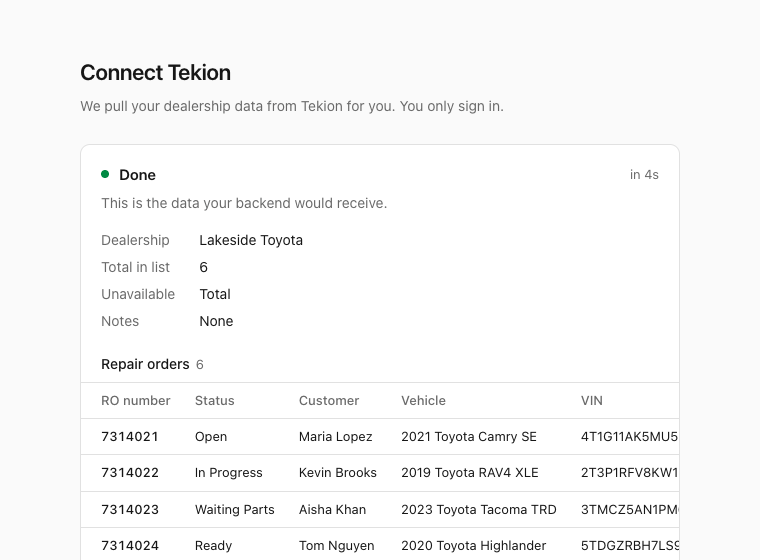
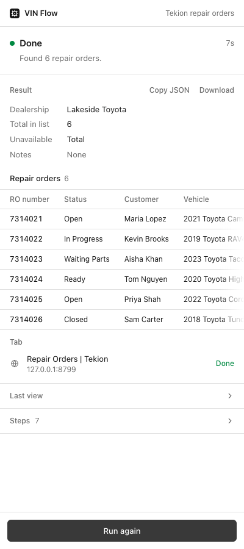
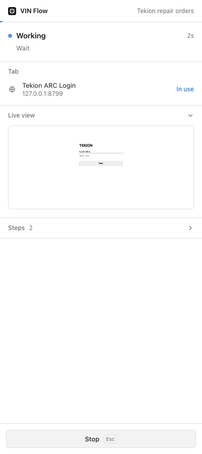
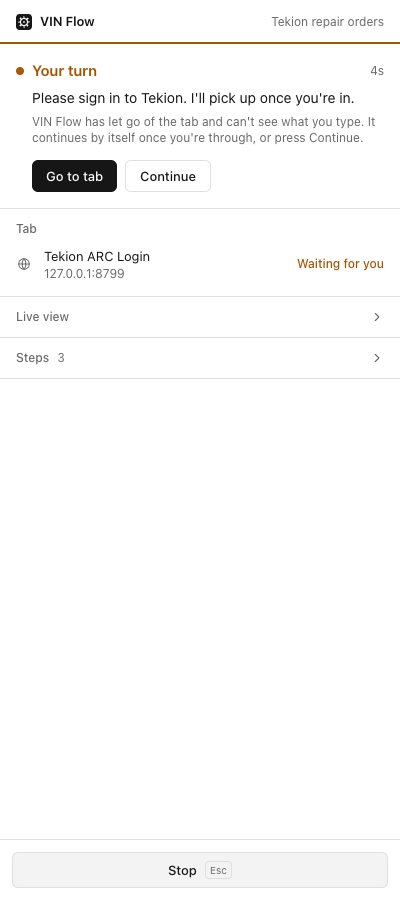

# VIN Flow

A fixed, read-only job run by a Chrome extension on the dealer's behalf, one flow per DMS. Your
product tells it which DMS the customer uses; the dealer presses **Start**; the extension opens
that DMS in a new tab (Tekion: the repair-order list), checks they're signed in (if not, it hands
the tab over and waits), reads what the flow asks for, adapts to what the account is allowed to
see, and hands back a structured result. It is built to only read: edits and write requests are
blocked (see Read only for exactly what that covers, and what it can't promise).

A clone of [Helm](../helm/) (the open-ended "drive this tab" concept), narrowed to one job.
Same stack: WXT 0.20, React 19, TypeScript (strict), Tailwind v4, pnpm.

| Your product's page | The extension's side panel |
|---|---|
|  |  |

## Run it

```bash
pnpm install
# put your key in .env:  OPENAI_API_KEY=sk-...   (read by the relay, never by the extension)
pnpm dev              # relay + hot reload in Chrome with a dev profile kept in .wxt/chrome-data
```

In your own Chrome profile:

1. `pnpm build:install` (builds and copies to `build/vin-flow-chrome`), and keep `pnpm relay` running.
2. `chrome://extensions` → Developer mode → **Load unpacked** → `build/vin-flow-chrome`.
3. Open the panel (toolbar icon or Alt+Shift+V) and press **Start**.

After code changes: `pnpm build:install`, then the reload arrow on the extension's card.
Ports differ from Helm's (relay 8797, dev server 3001) so both can run at once.

## Started from your front end

The product's page (FE) asks the dealer to install the extension, notices when it's there, and
offers **Start**. [`fe/index.html`](fe/index.html) is a working reference: `pnpm fe` serves it
on http://localhost:8790.

1. **Detect.** `chrome.runtime.sendMessage(EXTENSION_ID, { type: 'hello' }, reply)`. No reply
   (or no `chrome.runtime` at all) means not installed; poll until there is one. On install the
   extension reloads open FE tabs, because a page loaded earlier can't see it until it reloads.
2. **Start.** `sendMessage(EXTENSION_ID, { type: 'start', dms: 'tekion' })` **straight from the
   click handler**, with the DMS this customer uses (`hello.flows` lists the supported ones; an
   unknown DMS gets `{ ok: false, error }`). The extension opens its side panel next to the DMS
   tab, and Chrome allows that only during
   a user gesture. Checked in Chromium: a click on the page works; the same message sent 6s
   later is refused ("may only be called in response to a user gesture").
3. **Follow.** `chrome.runtime.connect(EXTENSION_ID, { name: 'vin-flow' })` streams
   `state`, `log`, `handoff` (the "please sign in" text), `result` (the data), `error`, `stopped`.
   When the result arrives the extension brings the FE tab back to the front. A real product
   POSTs `result.data` to its backend at that point.
4. `stop` and `continue` commands do what they say.

The protocol is typed in [`lib/protocol.ts`](lib/protocol.ts). Wiring:

- **Extension ID** `pemgbfmmbggmaogmcdjnpkjnjjleppjo`, fixed by the manifest `key` (public half
  of `.keys/vin-flow.pem`, gitignored) so it's the same wherever the folder is loaded. The Chrome
  Web Store assigns its own ID on publish; the FE's `EXTENSION_ID` changes then.
- **Which pages may connect**: `externally_connectable` in `wxt.config.ts`. localhost and
  127.0.0.1 always; add the product's origin with `FE_ORIGINS="https://app.example.com/*" pnpm build:install`.
  Those pages can start runs and receive the data, so keep the list to your own origins.
- The background worker relays between the FE and the panel. The panel sends a heartbeat (an
  idle service worker stops after ~30s, and signing in can take longer) and reconnects if the
  worker restarts. A Start isn't lost to a reconnect: the worker resends it on every panel
  connection until the panel reports it's running.

## The flows (one per DMS)

Each DMS has an entry in [`lib/flows.ts`](lib/flows.ts): the DMS's name, the title and summary the
dealer reads, `startUrl`, `allowedHosts` (its own sites), the model's `goal`, and the JSON schema
of the `result`. Add a DMS by adding an entry; the FE passes its id as `dms`.

- **`tekion`** (default): opens https://app.tekioncloud.com/ro/repair-orders/ro-list. Signed out,
  Tekion redirects to `/login?redirectTo=...` (username, Next); the extension hands over there and
  picks up when Tekion returns to the list. It reads the list as it opens (default filters and
  sort, up to 50 ROs, scrolling or paging as needed) into `repair_orders[]`: RO number, status,
  customer, vehicle, VIN, advisor, opened, promised, total, plus the dealership, the count the list
  reports, and the columns this account can't see. Live run on a fixture list: all 6 ROs exact,
  the hidden Total column reported as unavailable, 3 model calls, 18s.
- **`vinsolutions`**: who is signed in to VinSolutions and at which dealership (the earlier
  placeholder, kept as a second example).

## Read only

The goal: a run inside a customer's DMS changes nothing and does only the steps its flow names.
The prompt says so, and two layers enforce it in code, both failing closed (if a check can't be
made, the action is refused; if protection can't be switched on, or a blocked request can't be
held back, the run stops).

**1. An allowlist of actions** ([`lib/guard.ts`](lib/guard.ts)). Each flow lists what it may do
(`allow` in [`lib/flows.ts`](lib/flows.ts)); everything else is refused:

- open only the flow's own pages, exactly as listed (Tekion: the RO list, with its default
  filters); act (even hover) only on those pages; no going back, no other sites. New tabs the page
  opens are closed, except while the dealer has the tab (signing in, or closing a password
  manager's popup);
- click only controls the flow names, by their own accessible name: for a list flow, Next,
  Previous and the like. A bare page number or arrow counts only inside the page's pager, and an
  icon-only button only as an item of the pager (or named by one, like Ant Design's "Next Page").
  Even those are refused if they, any control around them that would also get the click, or the
  icons inside them look like they change data, are value controls, submit a form, sit in a frame
  or component it can't inspect, or link to any other page. The pointer is moved first and the
  target inspected after, through frames, shadow roots and slots;
- scroll (not over controls that change value on the wheel), read the page, and use only Tab and
  Esc. No typing, dragging, double, right or modifier clicks;
- every `confirm()`/`alert()` is dismissed with Cancel.

**2. A network firewall** ([`lib/firewall.ts`](lib/firewall.ts)), switched on before the DMS page
loads (the run starts from a blank tab), in the page, in frames from other sites, and (through the
page) in the page's own workers. Chrome holds each new frame and worker until it is protected; a
kind VIN Flow doesn't know stays held. Every XHR/fetch/form/beacon request, to any host, pauses
first:

- GET passes; PUT, PATCH and DELETE never leave the browser;
- a GraphQL mutation is blocked wherever it goes, found with a real lexer (comments and strings
  can't hide one); a document that doesn't parse, or a persisted operation with a write verb
  anywhere in its name, counts as one;
- opening the flow's page is a step the flow names, so while the page loads itself (before the
  run's first click, key, scroll or hover) its POSTs pass. That happens only on a page the run
  opened itself, one of the flow's pages, or a sign-in step; a page a click happens to land on gets
  nothing. Those POSTs are remembered with their body: keys and values, except the ones that vary
  from page to page (numbers, ids, dates, cursors), with JSON inside fields read too. After that a
  POST passes only if it matches one of those, or one the flow lists as an audited read. Another
  operation, action or status to the same address is blocked;
- a blocked request gets a 403 (a page load just fails), which apps and background-sync layers
  take as final instead of retrying later;
- after the dealer signs in, the flow's page is reopened with protection on so the firewall sees it
  load. After any other gap (a password manager's popup), nothing it learned is trusted again
  until a page loads under protection, except on a sign-in page (the dealer may be signing in).

Refusals show in the panel's step log and go to the model as a note, so it carries on reading.
Tested with fixtures that try typing, Save, checkboxes, a confirm, a shadow-DOM Delete, a number
field, a `javascript:` link, a form submit from outside the form, an icon button, a harmless-sounding
button the flow doesn't need, double and right clicks, other sites, POST, update and PUT requests,
a delete sent to the list's own address, a GraphQL mutation hidden between quoted comments, writes
from an out-of-process frame and a web worker, a "Next" slotted into a shadow link, an RO number
outside the pager, a pager button labelled only by a delete icon, and a click that lands on another
page which writes as it loads; the fixture server confirms no write request ever arrived. Three
Codex (gpt-6.1-sol) reviews and one Opus review shaped this design.

**What this can and can't promise.** It is designed to read the named flow, blocking editing
actions and unapproved requests. It is not an absolute guarantee, and it has not yet been checked
against a real Tekion account's paging traffic. Known gaps: the DMS's own code runs when a paging
control is clicked, and could write over a WebSocket (the extension can't pause WebSocket
messages), from a service or shared worker, or with a request that differs from one the page made
while loading only in values the firewall treats as varying (numbers, ids, dates, cursors);
Chrome lets requests through whenever the extension is detached (while the dealer signs in, when a
password manager's popup interrupts it, and after the run), including anything it was holding;
and a new tab the page opens is closed only after it appears. For a hard guarantee, have the
dealer sign in with a read-only DMS role, or use the DMS's official read API. Describe it to customers as "read only: it pages,
scrolls and reads, and blocks edits and write requests", not "can never change anything".

## Seeing what it's doing

- **Tab strip:** the tab the flow uses goes into a Chrome tab group whose label and colour follow
  the run: blue "VIN Flow · working", yellow "VIN Flow · your turn", green "VIN Flow · done", red
  "VIN Flow · error", grey "VIN Flow · stopped" (the group dissolves 20s after the run). The
  toolbar icon carries a matching badge. `lib/presence.ts`.
- **Side panel:** a pinned status line that answers "what is it doing" or "what do you need to
  do": Working with the current step; Your turn with the agent's message, Go to tab and Continue;
  Done with what it found; Stopped; Couldn't finish with the reason. Below it: the result (Copy
  JSON, Download), the tab in use and its state (In use, Waiting for you, Done; click to jump to
  it), a live view with numbered markers where it acted (click for full size, arrow keys for
  earlier views), and the step log, folded. Esc stops. Respects reduced motion.
- **Front end:** the same states on the product's page: the tab in use (title, host, Go to tab), a
  running timer, and on your turn the agent's message with a button straight to the DMS tab
  (`focus` command).

| Working | Your turn | Done |
|---|---|---|
|  |  |  |

## Password managers and other extensions

A password manager's inline menu (1Password's "Sign in" bubble, for one) is the other
extension's own page in an iframe. Chrome won't let one extension debug a page showing another
extension's frame: the moment the bubble appears it ends our session (reporting it as
`target_closed`, the same reason as a closed tab) and refuses to re-attach until the frame is gone.
Reproduced with a fixture extension that does the same (`e2e/fixtures/fake-pm`).

So when the session drops but the tab is still open, the extension steps back instead of
failing: on a sign-in page it asks the dealer to sign in (their password manager is right there);
elsewhere it asks them to close the other extension's popup. It retries every 1.5s and on
Continue, and picks up the moment Chrome lets it back in. Actions it had planned against the
page before the pause are skipped; the model looks again first.

## Permissions

`debugger`, `sidePanel`, `tabs`, `tabGroups` (no install warning). No host permissions and no storage: the flow is fixed in code
and nothing is remembered between runs. `externally_connectable` adds no install warning. Chrome's "started debugging this browser" bar shows
while the extension drives the tab; Cancel on it stops the run.

## Tests

```bash
pnpm check        # vitest (keys, geometry, sign-in detection, firewall rules) + tsc + build
pnpm test:e2e     # real Chromium, `--mode e2e` build, fake relay with scripted replies (21 scenarios:
                  # 15 flow incl. the read-only guard and click allowlist, network firewall (bodies,
                  # GraphQL, frames, workers, off-flow pages), DMS picker, password-manager popups;
                  # 6 front end: install prompt, Start to result, Stop, DMS input, one run at a time,
                  # events only to the starting tab)
pnpm test:live    # real model through the real relay on a fixture Tekion RO list (skips without a key)
```

Fixtures are served by a real local server (127.0.0.1:8799), not `page.route()`: the flow's tab
is opened by the extension and starts loading before Playwright could intercept it.

`e2e/screens.spec.ts` regenerates the light/dark screenshots in `docs/`.

## Open

- Confirm the Tekion fields and scope (which ROs: open only? a date range? how many?), and the
  backend endpoint the FE posts results to. Untested against a real Tekion account so far (no
  credentials here); the sign-in redirect was checked on the live site.
- `read_page` can't see inside cross-origin frames yet (would need per-frame CDP contexts).
- Before customers use it: real auth on the relay (it trusts any extension origin today), Cox's
  Terms of Use on automated access (the sign-in page warns against unauthorized access and
  credential sharing; the dealer signs in themselves, the extension never sees the password),
  and, if customer records are pulled, the FTC Safeguards Rule that covers dealers' customer data.
